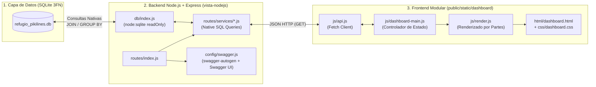

# Arquitectura General del Sistema

El módulo **`vista-nodejs`** está diseñado bajo una arquitectura en capas limpia y desacoplada, separando la conexión a datos, la lógica de rutas de la API REST, la autogeneración de documentación OpenAPI y el cliente web estático (SPA modular en ES6).

## Diagrama de Capas

---

## Responsabilidad de cada Directorio

### 1. `index.js` (Servidor Principal)
- Carga las variables de entorno (`.env`).
- Configura middlewares globales (`cors`, `morgan`, `express.json`, `express.urlencoded`).
- Antes de abrir el puerto HTTP (`3000`), ejecuta `generateSwagger()` para garantizar que el archivo `config/swagger-output.json` refleje siempre el estado actual del código en `routes/`.
- Monta el enrutador principal y un middleware centralizado de manejo de errores.

### 2. `db/index.js` (Capa de Acceso a Datos)
- Utiliza el módulo nativo `node:sqlite` (`DatabaseSync`) incluido en Node.js moderno, evitando dependencias binarias externas como `sqlite3` con `node-gyp`.
- Abre la base de datos `../generar-db/refugio_pikilines.db` en modo de **solo lectura (`readOnly: true`)**, garantizando que ninguna petición de consulta pueda alterar accidentalmente los datos.
- Expone dos funciones limpias con interfaz asíncrona:
  - `db.query(text, params)`: ejecuta una sentencia parametrizada (`?`) y devuelve `{ rows, rowCount }`.
  - `db.queryOne(text, params)`: ejecuta una sentencia parametrizada y devuelve únicamente el primer registro o `null`.

### 3. `routes/` y `routes/services/` (Capa de Controladores REST)
- `routes/index.js`: concentra el montaje de los servicios bajo `/api/*`, sirve la interfaz de Swagger en `/api-docs` y expone los archivos estáticos del frontend en `/static` y `/`.
- `routes/services/*.js`: divide los endpoints por dominio funcional (`resumen.js`, `animales.js`, `donaciones.js`, `refugio.js`), escribiendo **Native SQL Queries** explícitas sobre el modelo relacional en 3FN.

### 4. `config/swagger.js` (Documentación Automática)
- Utiliza `swagger-autogen` para analizar estáticamente los archivos de rutas, detectando los verbos HTTP, los parámetros en la ruta (`req.params`) y las variables desestructuradas del query string (`req.query`).

### 5. `public/static/dashboard/` (Capa de Presentación)
- Cliente web construido con **JavaScript Vanilla modular (ES6 Modules)** sin frameworks pesados.
- Separa estrictamente las llamadas HTTP (`api.js`), la navegación (`navigation.js`), los modales (`modal.js`), la generación de HTML (`render.js`) y la coordinación de eventos/paginación (`dashboard-main.js`).
